### `shivam@github:~$ whoami`

# Hi, I'm Shivam 👋

**I build interactive web experiences and developer tools.**

[Portfolio](https://shivam-s-portfolio-seven.vercel.app) · [ElementraUI](https://elementra-ui-website.vercel.app) · [Repositories](https://github.com/technoezmobile?tab=repositories)

---

## Selected work

<table>
<tr>
<td width="50%" valign="top">

### [ElementraUI](https://github.com/technoezmobile/ElementraUI-Website)

An open-source UI component discovery platform with verified previews, themes, templates, tools, icons, and motion resources.

[Explore the live site ↗](https://elementra-ui-website.vercel.app)

</td>
<td width="50%" valign="top">

### [ElementraUI Skill](https://github.com/technoezmobile/ElementraUI-Skill)

A portable AI coding skill for discovering, evaluating, and integrating ElementraUI resources.

[View the repository ↗](https://github.com/technoezmobile/ElementraUI-Skill)

</td>
</tr>
<tr>
<td colspan="2" valign="top">

### [Portfolio](https://github.com/technoezmobile/Shivam-s-Portfolio)

A home for my projects and experiments on the web.

[Visit the portfolio ↗](https://shivam-s-portfolio-seven.vercel.app)

</td>
</tr>
</table>

## Things I work with

`TypeScript` · `JavaScript` · `React` · `Tailwind CSS` · `Vite` · `Framer Motion` · `Three.js`

## Recent contributions

Generated from GitHub's public contribution calendar and refreshed daily. Private contributions are not included in this self-hosted public-data graph. The last generated graphic stays in place if GitHub is temporarily unavailable.

---

`Thanks for stopping by.` · [GitHub](https://github.com/technoezmobile)

<!-- Add the portrait from Shivam's supplied photo here before publishing the final profile. -->

