

  
  
  
  
  

<h3><code>shivam@github: ~ $ ./contributions.sh</code></h3>

 

<h3><code>shivam@github: ~ $ whoami</code></h3>

<table>
  <tr>
    <td valign="top"></td>
    <td valign="top"></td>
  </tr>
</table>

 

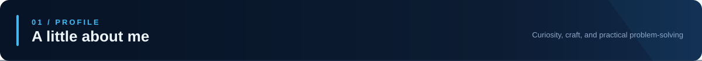

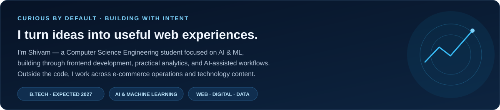

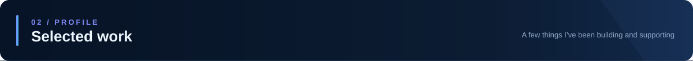

<a href="https://elementra-ui-website.vercel.app">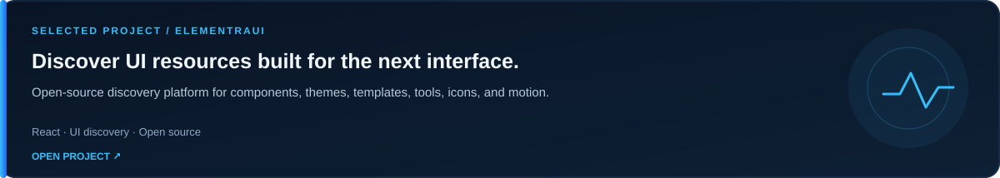</a>

<a href="https://tzroms.tzlabs.in">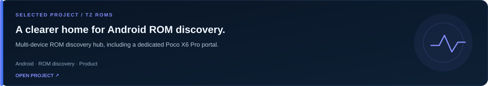</a>

<a href="https://physifer2-o.vercel.app">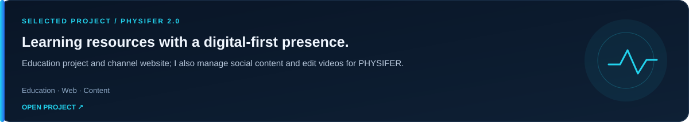</a>

<a href="https://tzlabs.in">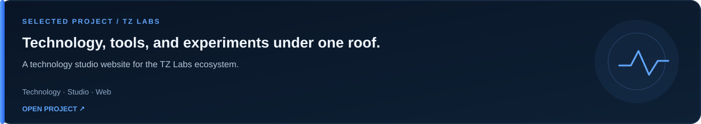</a>

<a href="https://prayanone.vercel.app">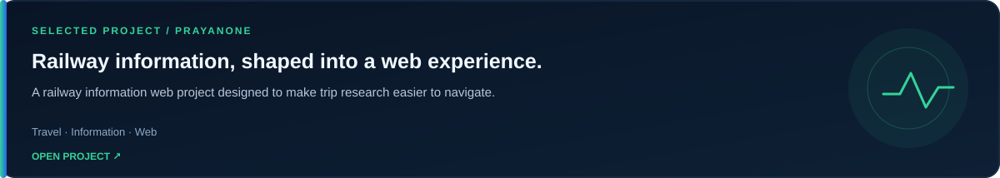</a>

<a href="https://greeneraorganics.vercel.app">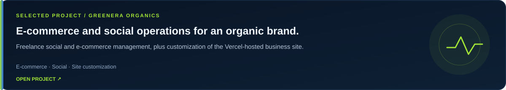</a>

<a href="https://apna-bazaar-three.vercel.app">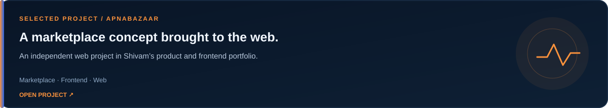</a>

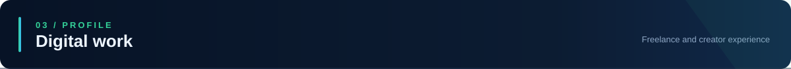

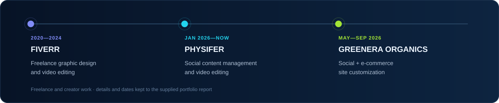

Earlier experience also includes supplier support, customer service, e-commerce operations, website management, SEO, and reporting.

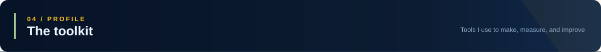

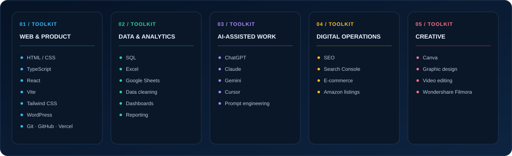

<h3><code>shivam@github: ~ $ ./channels.sh</code></h3>

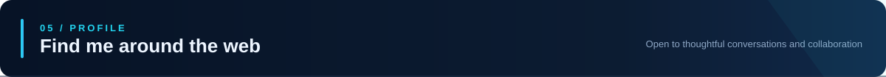

  
  

<a href="https://me.technoezmobile.com">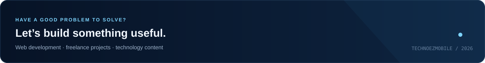</a>

The contribution calendar uses GitHub’s public activity page and refreshes daily. Private activity is not included.

