

# Shivam Singh

### AI-assisted Web Developer · CSE Student (AI & ML) · Digital Creator

**Building useful digital experiences with thoughtful craft.**

<a href="https://me.technoezmobile.com">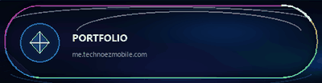</a>
<a href="https://www.linkedin.com/in/itsxshivam/">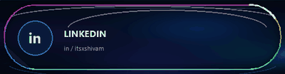</a>
<a href="https://github.com/technoezmobile">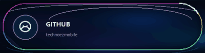</a>

<a href="./assets/profile-motion-reel.mp4"><strong>▶ Watch the profile motion reel (MP4)</strong></a>

<picture>
  <source media="(prefers-reduced-motion: reduce)" srcset="./assets/hero-motion-poster.png">
  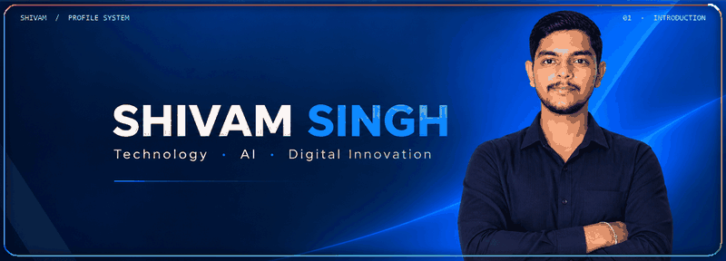
</picture>

## 01 · Identity card

<picture>
  <source media="(prefers-reduced-motion: reduce)" srcset="./assets/whoami-motion-poster.png">
  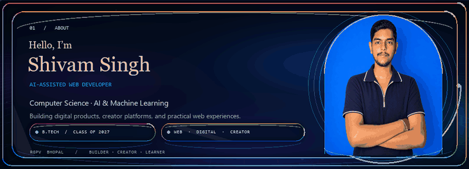
</picture>

I’m a Computer Science Engineering student focused on AI and machine learning, graduating in 2027. I build and improve web experiences, explore AI-assisted workflows, and work across creator content and digital operations.

**Currently interested in:** frontend engineering, useful AI, product craft, and digital experiences that feel clear and considered.

## 02 · Selected work

### ElementraUI · Open-source component discovery

<a href="https://elementra-ui-website.vercel.app"><picture><source media="(prefers-reduced-motion: reduce)" srcset="./assets/project-elementraui-motion-poster.png">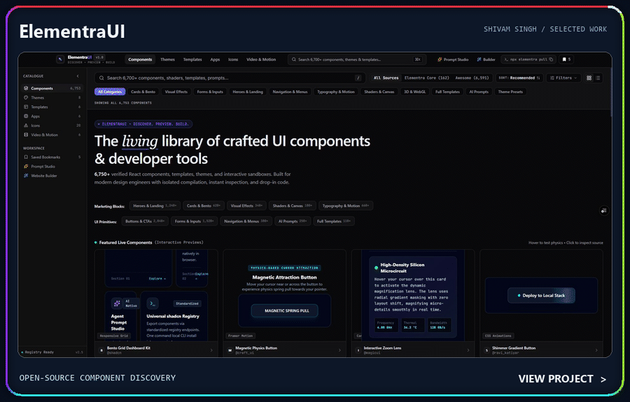</picture></a>

Discovery platform for components, themes, templates, tools, icons, and motion resources. [Open the website](https://elementra-ui-website.vercel.app) · [View the source](https://github.com/technoezmobile/ElementraUI-Website)

### TZ ROMs · Android ROM discovery

<a href="https://tzroms.tzlabs.in"><picture><source media="(prefers-reduced-motion: reduce)" srcset="./assets/project-tz-roms-motion-poster.png">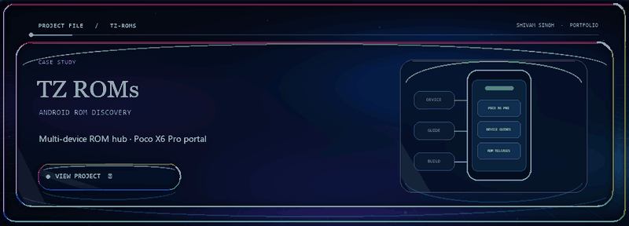</picture></a>

Multi-device Android ROM discovery hub, including a dedicated Poco X6 Pro portal. [Explore TZ ROMs](https://tzroms.tzlabs.in)

### PHYSIFER 2.0 · Education and creator platform

<a href="https://physifer2-o.vercel.app"><picture><source media="(prefers-reduced-motion: reduce)" srcset="./assets/project-physifer-motion-poster.png">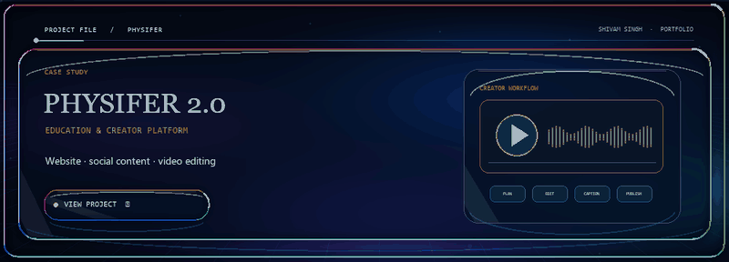</picture></a>

Education project and channel website. I also support social content and video editing. [Visit PHYSIFER 2.0](https://physifer2-o.vercel.app)

### TZ Labs · Technology studio

<a href="https://tzlabs.in"><picture><source media="(prefers-reduced-motion: reduce)" srcset="./assets/project-tzlabs-motion-poster.png">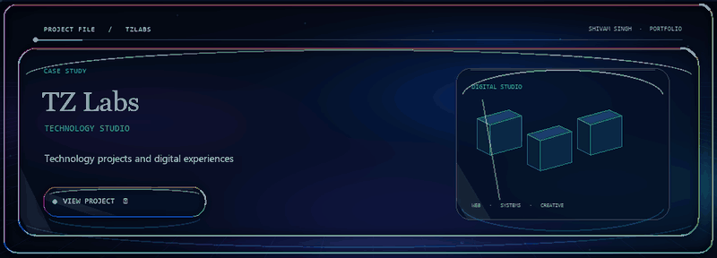</picture></a>

Technology studio for digital projects and experiences. [Visit TZ Labs](https://tzlabs.in)

### PrayanOne · Railway information

<a href="https://prayanone.vercel.app"><picture><source media="(prefers-reduced-motion: reduce)" srcset="./assets/project-prayanone-motion-poster.png">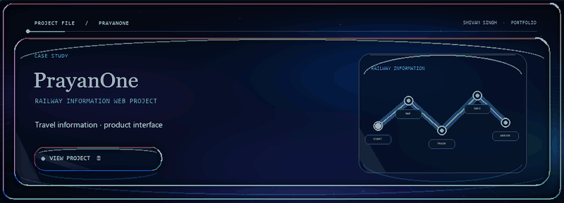</picture></a>

Railway information web project. [Explore PrayanOne](https://prayanone.vercel.app)

### Greenera Organics · E-commerce and digital operations

<a href="https://greeneraorganics.vercel.app"><picture><source media="(prefers-reduced-motion: reduce)" srcset="./assets/project-greenera-motion-poster.png">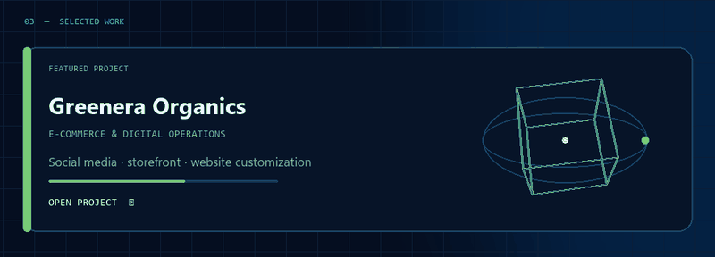</picture></a>

Freelance social media and e-commerce support, plus customization of the Vercel-hosted business website. [Visit the website](https://greeneraorganics.vercel.app)

### ApnaBazaar · Independent web project

<a href="https://apna-bazaar-three.vercel.app"><picture><source media="(prefers-reduced-motion: reduce)" srcset="./assets/project-apnabazaar-motion-poster.png">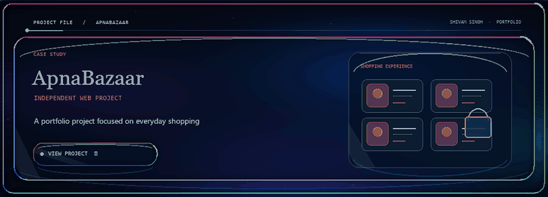</picture></a>

Independent portfolio project exploring a shopping experience. [Explore ApnaBazaar](https://apna-bazaar-three.vercel.app)

## 03 · GitHub activity

<picture>
  <source media="(prefers-reduced-motion: reduce)" srcset="./assets/contributions-motion-poster.png">
  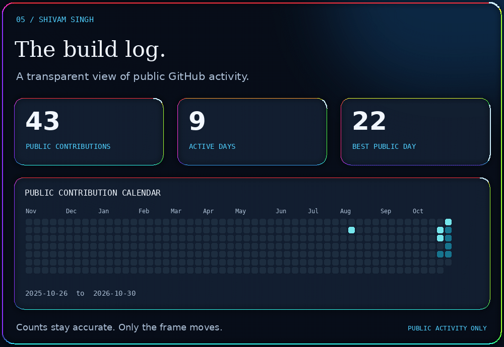
</picture>

The calendar uses public GitHub activity and refreshes daily. Private activity is not included.

## 04 · Experience

<picture>
  <source media="(prefers-reduced-motion: reduce)" srcset="./assets/experience-motion-poster.png">
  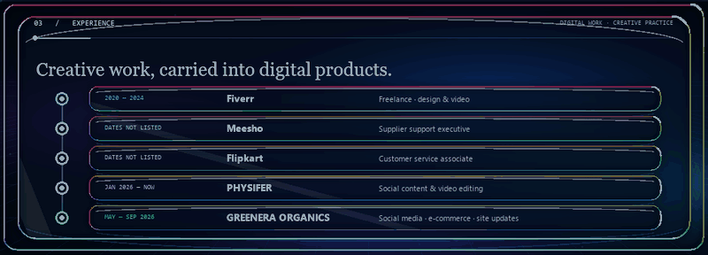
</picture>

Earlier work also includes supplier support, customer service, e-commerce operations, website management, SEO, and reporting.

## 05 · Toolkit

<picture>
  <source media="(prefers-reduced-motion: reduce)" srcset="./assets/toolkit-motion-poster.png">
  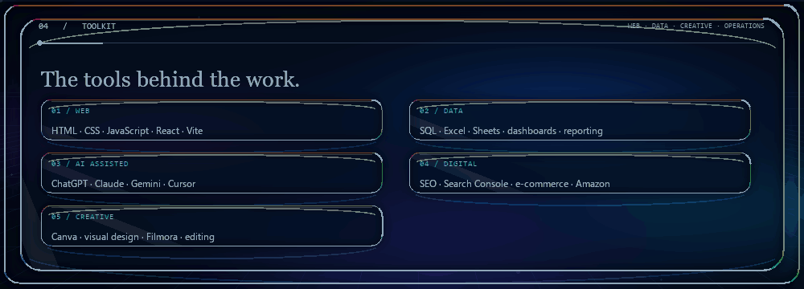
</picture>

## 06 · Creator channels

<picture>
  <source media="(prefers-reduced-motion: reduce)" srcset="./assets/channels-motion-poster.png">
  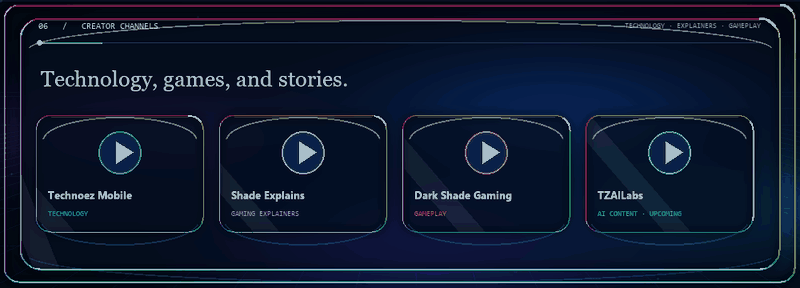
</picture>

- [Technoez Mobile](https://www.youtube.com/@Technoez_Mobile) · Technology
- [Shade Explains](https://www.youtube.com/@shade_explains) · Gaming explanations
- [Dark Shade Gaming](https://www.youtube.com/@Dark_Shade_Gaming) · Gaming videos
- [TZAILabs](https://www.youtube.com/@TZAILabs) · Upcoming AI content

## 07 · Let’s connect

<picture>
  <source media="(prefers-reduced-motion: reduce)" srcset="./assets/contact-motion-poster.png">
  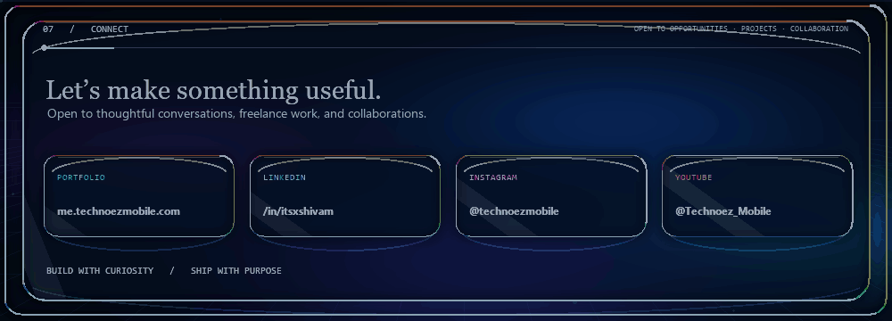
</picture>

<a href="https://instagram.com/technoezmobile">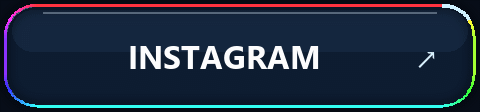</a>
<a href="https://www.youtube.com/@Technoez_Mobile">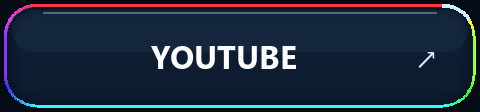</a>
<a href="https://telegram.me/tzlabss">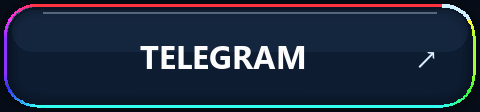</a>
<a href="mailto:contactme@technoezmobile.com">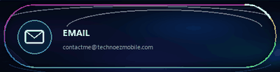</a>

- **Professional email:** [contactme@technoezmobile.com](mailto:contactme@technoezmobile.com)
- **Work inquiries:** [workwithtechnoez@gmail.com](mailto:workwithtechnoez@gmail.com)

*Build with curiosity · Ship with purpose*

